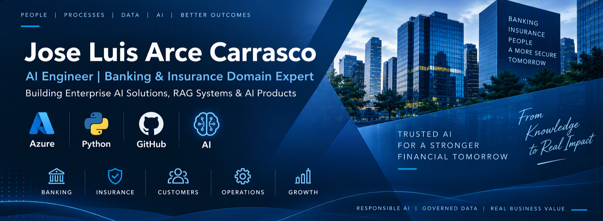

  

<!-- Animated professional headline -->

  

<h1 align="center">Hi there! Welcome to my GitHub profile 👋</h1>

# José Luis Arce

**AI Solutions Engineer | Banking & Insurance**

I combine **10+ years in banking and insurance operations** with training in Business Intelligence, Data Science, Microsoft Azure, and AI solution development.

My focus is designing business-oriented AI solutions for enterprise environments where reliable information, controlled knowledge sources, human oversight, and measurable business value matter.

## 💼 Professional Experience

My background includes banking operations, customer service, banking complaints, insurance claims, and administrative processes.

One of my most relevant experiences was creating and operating an internal administrative-procedures chatbot using **Power Virtual Agents, Excel, SharePoint, and Power BI**.

Deployed to approximately **3,000 bank employees**, it became an internal information channel. My responsibilities included organizing procedural knowledge, coordinating content updates, managing modification access, monitoring usage, and reporting results to management.

## 🚀 Featured Projects

### AI Solution Development Standard

A business-first, documentation-first, cloud-agnostic framework for structuring AI initiatives before implementation.

It provides a foundation for business discovery, requirements, solution design, authorized knowledge sources, human oversight, evaluation, and project readiness.

**Status:** `v0.1.0-draft` — Ready for practical validation with conditions.

### Internal Banking Operations Copilot

A practical AI Engineering portfolio project focused on helping banking operations teams retrieve operational requirements and documentation through a controlled knowledge assistant.

**Status:** Business discovery and planning.

## 🛠️ Technical Skills

**AI & Cloud**

**Programming & Data**

**Development Tools & Practices**

- AI-assisted development
- Specification-Driven Development
- Prompt and workflow design

**Currently strengthening:** Software architecture, API development, RAG systems, AI evaluation, automated testing, authentication, authorization, and cloud deployment.

## 🧭 Engineering Approach

**Build the right solution before optimizing how to build it.**

I start with the business problem, users, available evidence, authorized knowledge sources, expected outcomes, and risks before selecting models or technologies.

My priorities:
- Business value over technology trends.
- Deterministic logic for fixed rules and authoritative calculations.
- AI where interpretation creates measurable value.
- Human oversight for high-impact decisions.
- Evaluation, traceability, and operational reliability.

## 🎯 Career Objective

I aim to contribute as an **AI Solutions Engineer**, combining business domain knowledge and AI engineering to design and build practical, reliable, and responsible enterprise solutions, particularly in banking, insurance, and other information-sensitive environments.

## 📜 Certifications

- Microsoft Certified: Azure AI Engineer Associate (AI-102)
- Microsoft Certified: Azure Fundamentals (AZ-900)

## 📫 Connect with Me

  
  

🌎 **Languages:** Spanish (Native) | English (Technical reading and ongoing professional development)
